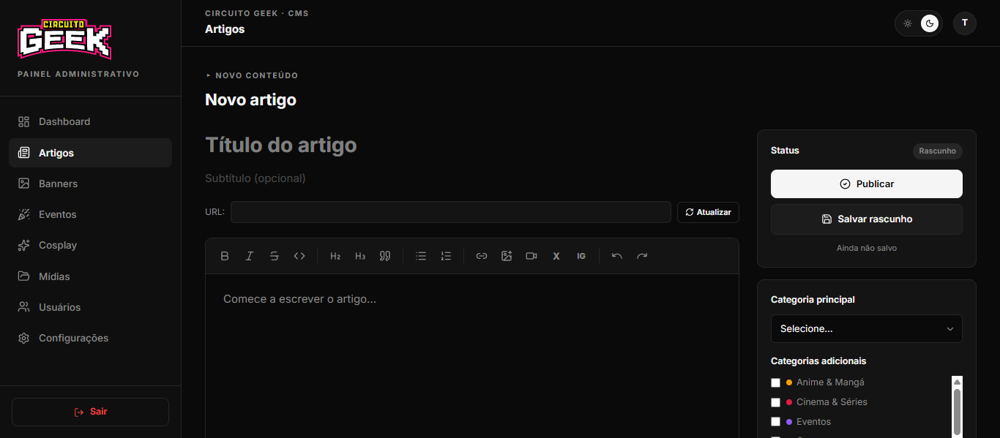
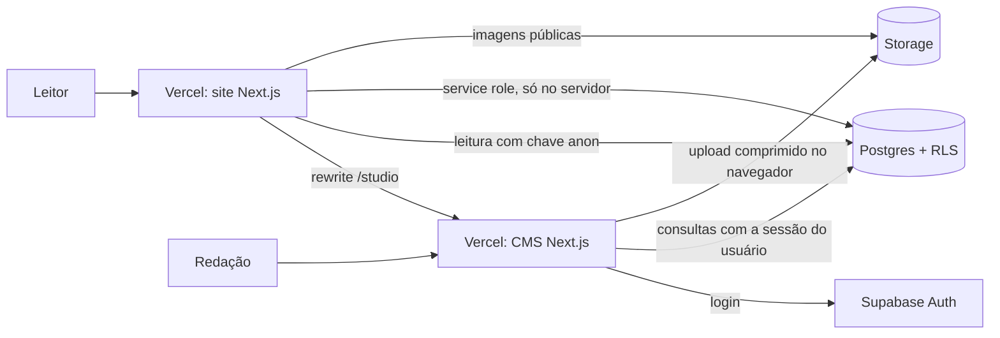

# Circuito Geek

Portal de notícias sobre cultura geek com CMS próprio, feito por mim do código ao conteúdo. No ar em [circuitogeekmg.com.br](https://www.circuitogeekmg.com.br).

      

> Este repositório documenta o projeto como case técnico. O código-fonte fica em repositórios privados; posso mostrar trechos e explicar qualquer decisão em entrevista.

## O que é

O Circuito Geek tem duas partes:

- **Site público**, onde o leitor encontra notícias, reviews, agenda de eventos e o concurso de cosplay.
- **CMS da redação**, servido em `/studio`, onde os artigos são escritos, revisados e publicados.

Eu escrevo e publico o conteúdo, então o painel foi pensado a partir do meu próprio fluxo de trabalho.

## O problema

Eu precisava de um fluxo editorial com revisão antes de ir ao ar, de um editor com embeds de posts do X e do Instagram, de upload de imagem que já entregasse arquivos leves e de controle total sobre o HTML que chega ao leitor. O projeto começou com Sanity e migrou para Supabase com um CMS próprio, construído em cima dessas necessidades.

O CMS cobre artigos (com status de rascunho, revisão, agendado, publicado e arquivado), banners, eventos, mídias, usuários, configurações e a gestão do concurso de cosplay.

## Arquitetura

São dois deploys separados na Vercel que compartilham o mesmo Supabase. O CMS roda com `basePath: '/studio'` e o site faz um rewrite para ele, então o navegador continua em `circuitogeekmg.com.br/studio`, sem trocar de domínio.

## Decisões técnicas

### Segurança e dados

**Autorização no banco, não só na tela.** O CMS usa apenas a chave anon e a sessão de quem está logado, sem service role. Quem protege os dados é a Row Level Security do Supabase. Esconder um botão na interface é conveniência, não segurança.

**Escrita sensível só no servidor.** No site, as páginas leem artigos, categorias, mídias e uma view pública de autores com a chave anon. Inscrição e votação do concurso passam por Route Handlers que usam a service role. Esse cliente fica num arquivo com `import 'server-only'`, então o build quebra se alguém importá-lo por engano em código de navegador.

**Rate limit por IP nas rotas de API.** Usa Upstash Redis em produção e cai para memória em desenvolvimento.

**Busca sem injeção de filtro.** Em vez de montar um filtro `.or()` com o termo do usuário interpolado, a busca faz duas consultas `.ilike()` parametrizadas e mescla os resultados no servidor.

**Proteção de rotas no middleware.** Sem sessão, as rotas do painel redirecionam para o login, e a gestão de usuários só abre para administradores. O redirect usa `request.nextUrl.clone()` para preservar o `basePath`.

### Conteúdo e HTML

**Sanitização em duas camadas.** No CMS, a pré-visualização usa DOMPurify com `iframe` restrito ao YouTube, porque outra pessoa da equipe pode abrir o preview. No site, o HTML é sanitizado de novo com `sanitize-html`: lista fechada de tags e atributos, e blockquotes do X e do Instagram só passam se o link tiver o formato de um post. Mesmo que alguém grave HTML direto no banco, a segunda camada impede que ele chegue ao leitor.

No site, troquei DOMPurify por `sanitize-html` porque o jsdom puxava um módulo ESM incompatível com o runtime da Vercel e derrubava a página do artigo com erro 500.

**Embeds como nó próprio no Tiptap.** A extensão `EmbedSocial` valida a URL do post do X ou do Instagram e grava só o markup oficial de embed com o link. No site, os scripts do X e do Instagram só são baixados em artigos que têm embed, e só quando o primeiro chega perto da tela (`IntersectionObserver`).

### Imagens e performance

**Compressão no navegador antes do upload.** A imagem é redimensionada em Canvas (sem ampliar), convertida para JPEG e mantida no original se o resultado não ficar menor. Saem até três arquivos: principal (até 1920 px, qualidade 0.8), `-m` (960 px) e `-c` (480 px), cada um gerado só quando a imagem passa daquele tamanho. GIF e SVG sobem sem recompressão, e os arquivos recebem `cache-control` de um ano. O editor também tem recorte com ponto focal.

**Otimizador de imagens desligado no site.** A cota do otimizador da Vercel no plano gratuito estourou e as imagens passaram a retornar erro 402. Hoje elas saem direto do Supabase Storage, e os cards usam a variante de 480 px gerada pelo CMS.

**Build com webpack.** O build usa `next build --webpack` para contornar falhas na Vercel com `next/font/google` e Turbopack.

## Fluxo editorial

| Papel | O que faz no CMS |
|---|---|
| Administrador | Publica, devolve para rascunho e gerencia usuários |
| Editor-chefe | Publica e devolve para rascunho |
| Revisor | Devolve artigos em revisão |
| Redação | Salva rascunho e envia para revisão; artigo publicado ou agendado fica travado |

## Stack

| Camada | Tecnologia |
|---|---|
| Site e CMS | Next.js 16 (App Router), React 19, TypeScript, Tailwind CSS v4 |
| Editor | Tiptap 3 com extensões próprias, react-easy-crop |
| Banco, login e arquivos | Supabase (Postgres com RLS, Auth, Storage) |
| Segurança de conteúdo | sanitize-html (site), DOMPurify (preview do CMS) |
| Rate limit | Upstash Redis |
| Deploy e métricas | Vercel, Vercel Analytics |

## Próximos passos

1. Versionar o schema e as policies de RLS em migrations, para o projeto ser reproduzível do zero.
2. Servir as variantes de imagem com `srcset` e `sizes`, ou com um loader próprio, e voltar a ter imagens responsivas sem depender da cota da Vercel.
3. Trocar a renderização dinâmica da página do artigo por ISR com revalidação sob demanda, reduzindo consultas ao banco.
4. Implementar a publicação agendada automática.
5. Transformar os testes manuais de XSS e de injeção de filtro em testes automatizados rodando no CI.

## Autor

Thiago Raphael, desenvolvedor web.
[thiagoraphael.com.br](https://www.thiagoraphael.com.br) · [LinkedIn](https://www.linkedin.com/in/thiagoraphaeljustiniano/) · [GitHub](https://github.com/thiagoraphael)